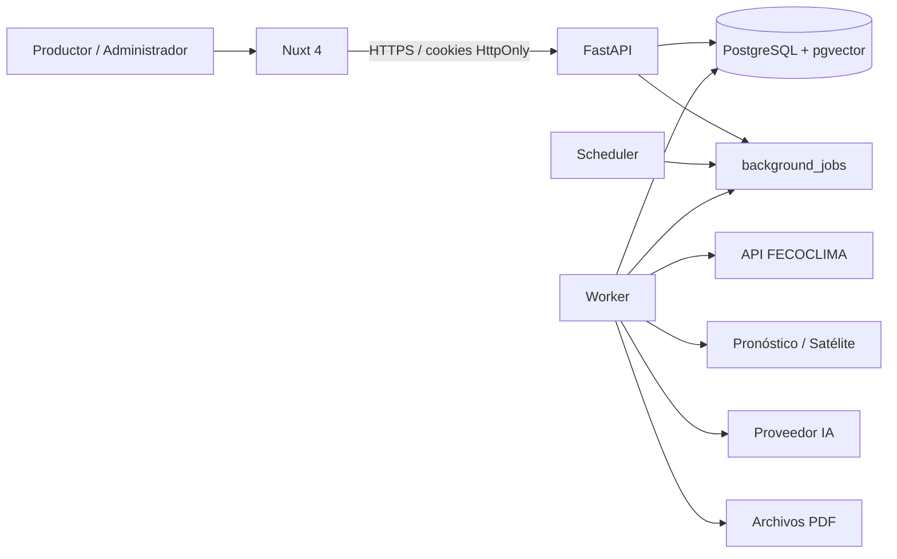

# Arquitectura

FECOCLIMA IA separa la interfaz, el API HTTP, el procesamiento asíncrono y el agendamiento periódico.

- **Nuxt 4** consume únicamente el backend. La llave de FECOCLIMA nunca llega al navegador.
- **FastAPI** expone autenticación, recursos administrativos, dashboard y creación de trabajos.
- **PostgreSQL + pgvector** persiste datos meteorológicos, reglas, alertas, auditoría, reportes y conocimiento.
- **Worker** toma trabajos con `FOR UPDATE SKIP LOCKED` para sincronizar, evaluar, indexar y generar PDF.
- **Scheduler** crea trabajos periódicos; no se ejecuta dentro de las réplicas HTTP.
- **Adaptadores** aíslan FECOCLIMA, pronóstico, satélite, SMTP e IA.

