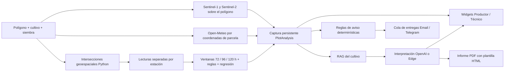

# Inteligencia agronómica por parcela

La entrada principal del portal (`/fecoclima-ia`) es la parcela. La consulta histórica por estación se conserva en `/fecoclima-ia/clima`. El selector Productor/Técnico cambia el detalle presentado sobre el mismo análisis.

## Flujo de uso

1. Registre estaciones en el CMS: coordenadas, radio o polígono de influencia, GUID y endpoint HTTPS opcional. Las claves de FECOCLIMA permanecen en el backend.
2. Cree usuarios con rol **Productor** o **Analista** desde el CMS. El portal público y su ingreso viven bajo `/fecoclima-ia`; el CMS usa rutas administrativas separadas y solo admite roles **Superadministrador** y **Administrador**.
3. En `/fecoclima-ia`, explore el mapa mundial y dibuje la parcela. El mapa colorea las áreas de influencia configuradas para estaciones activas y calcula la intersección en Python. El análisis se habilita cuando al menos el 99% del polígono queda cubierto.
4. Elija Trigo o Soja e indique la fecha de siembra. Al iniciar el análisis, se guarda la parcela, se encola la actualización de estaciones/satélite, se crea la captura determinística y se ejecutan los agentes de los widgets. La captura usa los datos disponibles en ese momento; la actualización de fuentes continúa en segundo plano.
5. Desde **Agentes IA**, configure proveedor y modelo para los roles por cultivo. Vincule los documentos de Trigo/Soja al agente **RAG agronómico por cultivo**. Su lista de documentos es explícita; un agente sin documentos vinculados no hereda los de otro agente.
6. En la parcela, revise la condición compilada antes de activar un aviso por Email o Telegram. SMTP y el bot se configuran mediante las integraciones existentes.

## Mapa mundial

El frontend usa MapLibre GL JS para navegar el globo y Terra Draw para dibujar el polígono. MapTiler Cloud sirve el mapa base y las imágenes satelitales; el campo `NUXT_PUBLIC_MAPTILER_KEY` se configura en `frontend/.env`. La clave llega al navegador, por lo que debe restringirse por origen HTTP en MapTiler. Sin clave se muestra una capa de demostración sin satélite. Para uso institucional/comercial, el plan Free de MapTiler no aplica; revise su plan comercial vigente antes de publicar.

Las zonas se devuelven desde `/api/v1/public/stations` con el polígono de CMS o un círculo geodésico derivado del radio. `/api/v1/public/parcel-coverage` devuelve las intersecciones medidas por el backend. La selección geográfica es pública; guardar la parcela, consultar análisis y activar agentes requiere sesión de Productor o Técnico.

Esta integración usa [MapLibre GL JS](https://maplibre.org/maplibre-gl-js/docs/examples/display-a-globe-with-a-vector-map/) y [Terra Draw](https://github.com/JamesLMilner/terra-draw). No depende de Google Maps Drawing Library, retirada en mayo de 2026 según [Google Maps Platform](https://developers.google.com/maps/deprecations).

Los módulos son: lecturas crudas, seis condiciones de alerta, fenología estimada, diagnóstico de IA, satélite y punto de inspección, enfermedades posibles, pronóstico/tendencia a tres días y chat contextual.

## Separación de responsabilidades



- `geospatial.py`: validación WGS84, círculos geodésicos, intersecciones y áreas en una proyección local equivalente. Admite Polygon/MultiPolygon y huecos. Máximo 5000 vértices y extensión de diez grados por eje. Una estación sin cobertura no se selecciona por proximidad. Los porcentajes de cobertura se calculan sobre la unión de áreas para no duplicar solapamientos.
- `plot_pipeline.py`: todas las operaciones numéricas antes de invocar IA. Ventanas `(referencia − horas, referencia]`, sin fechas futuras ni duplicados. Se anclan al momento del análisis, no a una lectura vieja. Las estaciones se evalúan por separado; el nivel de parcela toma la estación más grave cuando toda la cobertura es evaluable. Menos del 99% de cobertura espacial, series atrasadas o menos del 80% de lecturas producen datos insuficientes.
- Se reutilizan las seis condiciones diarias publicadas. Se conservan los acumulados observados; **lluvia y mojado acumulado se comparan como equivalentes diarios** (`acumulado × 24 / horas`). Cuando el sensor ya entrega horas diarias, se conserva su media sin normalizarla nuevamente. Este criterio está expuesto en la captura y debe revisarse con el equipo agronómico antes de introducir reglas específicas para ventanas acumuladas. No se introducen umbrales agronómicos nuevos.
- Los valores no finitos o fuera de los rangos de calidad existentes no alimentan los resúmenes. Se mide cobertura por variable; faltantes suficientes impiden evaluar su condición. Las unidades de humedad del suelo se respetan: centibares no se convierten en porcentaje sin una calibración. Reglas con unidades incompatibles reciben dato faltante.
- La regresión OLS usa días completos locales de los últimos treinta días. Requiere al menos siete días con 80% de las muestras esperadas por variable. Publica pendiente, error y proyección por estación. Se presenta separada del pronóstico Open-Meteo; no se mezclan ambos resultados ni se anuncia precisión predictiva validada. El pronóstico se reutiliza durante seis horas desde su generación real.
- `plot_agents.py`: enruta cada propósito al agente configurado, recupera evidencia del cultivo y conserva ejecuciones auditables. El orquestador recibe el contexto completo y las interpretaciones ya solicitadas para otros widgets. Cada widget se interpreta bajo demanda. El estado `fallback` identifica un resumen determinístico cuando falta agente, proveedor o soporte de imágenes.
- `plot_satellite.py`: reutiliza el procesamiento óptico existente, pasando el **ID real de parcela**. Sentinel-1 usa su colección, bandas VV/VH y máscara; sus valores gamma0 lineales no se presentan como NDVI. Se guardan rasters TIFF independientes. Los píxeles válidos del raster NDVI permiten calcular en Python un punto dentro de la parcela. Sin píxeles utilizables se presenta un punto interior de referencia, sin atribuirle anomalías. La malla de localización es de 128 × 128: las coordenadas no implican precisión submétrica ni diagnóstico confirmado.
- Cada producto conserva geometría y estaciones influyentes. Cambiar el polígono invalida la reutilización del producto anterior. Las imágenes de parcelas requieren sesión y autorización; las imágenes públicas siguen destinadas a las geozonas de estaciones.
- `plot_chat.py`: conserva mensajes por usuario y captura. Se retienen hasta cien mensajes; se envían los doce más recientes, el contexto completo y hasta cuatro fotos recientes, con un máximo de 16 MB. Las fotos se almacenan de forma privada y pueden volver a adjuntarse al modelo en preguntas posteriores. Un nuevo análisis abre otro contexto de conversación.
- `plot_alerts.py`: compilador restringido en español, sin `eval()` ni decisiones de un LLM. Admite hasta cuatro condiciones unidas por `y` o por `o`; rechaza mezclas, unidades incompatibles y texto ambiguo. Las condiciones conjuntas deben cumplirse en una misma estación. Por defecto compara la última lectura de hasta una hora; `en 72/96/120 horas` compara medias disponibles de temperatura/humedad. Lluvia y viento solo admiten última lectura. No se resuelven reglas como `humedad X y temperatura Y` sin umbrales numéricos explícitos.
- Scheduler cada cinco minutos → monitor → outbox persistente → despacho. Hay enfriamiento configurable (180 minutos por defecto), bloqueo de filas y hasta tres intentos. Un fallo posterior al envío pero anterior a confirmar la transacción puede duplicar una entrega; no se promete exactamente una entrega. Desactivar una regla cancela sus entregas pendientes al despacharlas.
- `plot_reporting.py`: PDF en el worker. Plantillas Jinja con HTML/CSS sobre datos ya calculados, variables `context`, `narrative` y `narrative_html`. Se escapan los datos, se bloquean recursos remotos/archivos y se rechaza aritmética en la plantilla. Los informes se descargan únicamente tras autorización.

## Proveedores por agente

Se conservan `AI_BASE_URL`, `AI_API_KEY`, `AI_DEFAULT_MODEL` y las variables de embeddings existentes para OpenAI. La conexión Edge requiere una API compatible con Chat Completions:

```dotenv
EDGE_AI_BASE_URL=http://servidor-edge:11434/v1
EDGE_AI_API_KEY=
EDGE_AI_DEFAULT_MODEL=gemma3
EDGE_AI_SUPPORTS_IMAGES=false
```

`OPENAI` y `EDGE` se persisten en cada versión de agente. La dirección y credenciales se resuelven únicamente en el backend. No hay cambio automático de Edge a OpenAI. Las consultas del flujo de parcela ejecutadas con Edge usan recuperación léxica local para evitar generar embeddings de la consulta en OpenAI. Para procesar fotos o RGB con Edge, habilite `EDGE_AI_SUPPORTS_IMAGES` solo si el modelo servido admite imágenes.

La estructura de Chat Completions e imágenes se contrastó con [OpenAI Docs](https://developers.openai.com/api/reference/resources/chat/subresources/completions/methods/create). El adaptador radar sigue los parámetros de [Sentinel-1 GRD](https://documentation.dataspace.copernicus.eu/APIs/SentinelHub/Data/S1GRD.html). El adaptador de pronóstico existente utiliza [Open-Meteo](https://open-meteo.com/en/docs).

## Endpoints

Todos los nuevos endpoints están bajo `/api/v1/parcels`, requieren sesión y verifican propiedad/rol. Las mutaciones usan la protección CSRF existente.

| Operación | Ruta relativa |
| --- | --- |
| Listar / crear | `GET /`, `POST /` |
| Configurar / desactivar | `PUT /{plot_id}`, `DELETE /{plot_id}` |
| Cobertura actual | `GET /{plot_id}/influences` |
| Generar captura / leer última | `POST /{plot_id}/analyses`, `GET /{plot_id}/analyses/latest` |
| Encolar sincronización | `POST /{plot_id}/refresh` |
| Interpretar widget | `POST /analyses/{analysis_id}/interpret` |
| Leer / enviar chat multipart | `GET /analyses/{analysis_id}/chat`, `POST /analyses/{analysis_id}/chat` |
| Compilar aviso | `POST /alert-rules/compile` |
| Listar / crear / desactivar avisos | `GET/POST /{plot_id}/alert-rules`, `DELETE /{plot_id}/alert-rules/{rule_id}` |
| Historial de entregas | `GET /{plot_id}/alert-deliveries` |
| Solicitar PDF | `POST /analyses/{analysis_id}/reports` |
| Estado / descargar PDF | `GET /reports/{report_id}`, `GET /reports/{report_id}/file` |
| Imagen privada | `GET /{plot_id}/satellite/{observation_id}/{layer}` |

El endpoint HTTPS opcional de estación admite `{guid}`, `{year}`, `{month_from}`, `{month_to}`. Sin endpoint propio se usa `FECOCLIMA_BASE_URL`. `FECOCLIMA_API_KEY`, timeout de treinta segundos y tres intentos conservan su funcionamiento.

## Actualización y verificación

La migración `0006_plot_intelligence` agrega siembra y endpoint, permite parcelas sin estación cuando no existe cobertura y crea tablas de estaciones influyentes, capturas, conversaciones, reglas, entregas e informes. No elimina registros históricos. El rollback mantiene `plots.station_id` nullable para no asignar arbitrariamente parcelas sin cobertura.

Desde `backend/`, después de revisar las variables de entorno:

```bash
docker compose build migrate api worker scheduler
docker compose run --rm migrate
docker compose up -d api worker scheduler
```

El servicio `migrate` aplica Alembic y el seed idempotente, incluyendo roles y los nuevos propósitos de agentes. Compile y reinicie el frontend según su despliegue habitual. No reinicie API con modelos nuevos sobre una base que aún no tiene la migración.

Pruebas locales:

```bash
STORAGE_PATH=/tmp/fecoclima-tests MPLCONFIGDIR=/tmp/fecoclima-mpl .venv/bin/pytest -q
```

Las pruebas PostgreSQL están separadas y se omiten si no existe `FECOCLIMA_TEST_DB_URL`. Utilizan exclusivamente el contenedor temporal en el puerto 55439; nunca usan `DATABASE_URL` de producción. Aplique primero las migraciones a esa base temporal y ejecute:

```bash
FECOCLIMA_TEST_DB_URL=postgresql+asyncpg://postgres@127.0.0.1:55439/postgres \
STORAGE_PATH=/tmp/fecoclima-tests .venv/bin/pytest -q tests/test_plot_integration.py
```

Las integraciones externas y los envíos se simulan en estas pruebas. La validación real de cuentas, permisos de Copernicus, modelo Edge y destinatarios corresponde al ambiente donde se activen.
